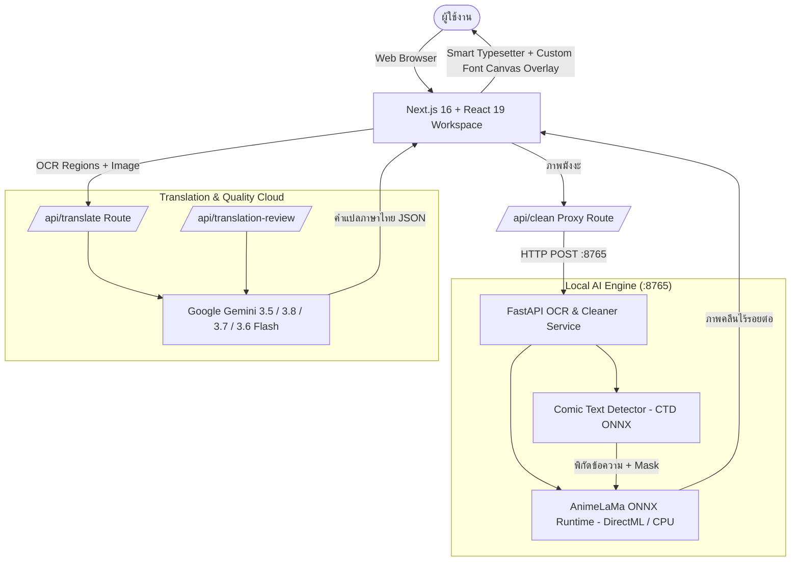

# ⚡ SuperK Manga Translator

ระบบเว็บแอปพลิเคชันสำหรับ **แปลและคลีนมังงะอัตโนมัติ** ผสานพลัง **Local AI Inpainting (ลบตัวหนังสือบนเครื่อง 100% ฟรีและปลอดภัย)** ร่วมกับ **Multi-Model AI Translation (แปลภาษาไทยสละสลวยเป็นธรรมชาติ)** พร้อมเครื่องมือจัดเรียงข้อความ (Smart Typesetter) คลังฟอนต์มังงะไทย 16 แบบ และสตูดิโอปรับแต่งบอลลูนระดับมืออาชีพ

---

## 🌟 จุดเด่นของโปรเจกต์ (Key Features)

- 🧹 **Local-First AI Inpainting & Instant Artwork Restore (ลบเนียนกริบ + กู้ภาพเดิมทันที):**
  - ตรวจจับข้อความมังงะอัตโนมัติด้วย **Comic Text Detector (CTD)**
  - ลบตัวอักษรและซ่อมแซมพื้นหลังด้วยโมเดล **LaMa Large (Anime Big LaMa)** ลบได้ทั้งบอลลูนขาว ลายฉากหลังซับซ้อน ลายเส้นผม และเสื้อผ้าบนเครื่องของคุณเอง 100%
  - **Mask Editor & Instant Local Restore:** พ่นแก้จุดคลีนเฉพาะส่วน หรือกด **`กู้ภาพเดิมทั้งจุด` / `กู้เฉพาะส่วน` / `ล้างกรอบนี้`** เพื่อกู้คืนลายเส้นต้นฉบับกลับมาได้ทันทีระดับพิกเซล (ทำงานได้ทันทีแม้เซิร์ฟเวอร์คลีนปิดอยู่)
- 🔤 **Thai Manga Font Pack (16 ฟอนต์ไทยคัดพิเศษ) & Custom Font Upload:**
  - มาพร้อมฟอนต์มังงะและคอมิกภาษาไทยในตัว **16 แบบ** แบ่งตามอารมณ์การใช้งาน 4 หมวดหมู่:
    - 🎨 **แนวมังงะ / ลายมือ:** `Itim`, `Mali`, `Sriracha`, `Charm`, `Pattaya`
    - 💬 **แนวบทพูดอ่านง่าย / โมเดิร์น:** `Mitr`, `Kodchasan`, `Kanit`, `Prompt`, `Bai Jamjuree`, `IBM Plex Sans Thai`
    - ⚡ **แนวแอ็กชัน / ไซไฟ / เสียงเอฟเฟกต์ (SFX):** `Chakra Petch`, `K2D`, `Chonburi`
    - 📖 **แนวบรรยาย / ทางการ:** `Sarabun`, `Pridi`
  - **Searchable & Categorized Font Picker:** ตัวเลือกฟอนต์ดีไซน์เดียวกับตัวเลือกโมเดล AI ค้นหาด้วยชื่อฟอนต์หรือสไตล์ภาษาไทย (เช่น *โชเน็น*, *ลายมือ*, *แอ็กชัน*) กรองตามหมวดหมู่ และแสดงตัวอย่างหน้าตาฟอนต์จริงในทุกแถวทันที
  - **อัปโหลดฟอนต์ของคุณเอง (`.ttf`, `.otf`, `.woff`, `.woff2`):** เพิ่มฟอนต์ไทยยอดฮิตจากคอมพิวเตอร์ของคุณ (เช่นตระกูล *Layiji*, *FC*, *SOV*) บันทึกถาวรลง IndexedDB ในเบราว์เซอร์ และเรนเดอร์ลงทั้งหน้าแคนวาสสดรวมถึงไฟล์ส่งออก `PDF` / `ZIP` / `CBZ` / `PNG`
- 📐 **Smart Balanced Manga Typesetter (`จัดระเบียบ` v4 & โหมด `ขยายตัวใหญ่พิเศษ XL`):**
  - จัดวางข้อความภาษาไทยคำนวณตามทรงวงรีของบับเบิล (Oval Chord Geometry) และตัดคำตามขอบเขตคำภาษาไทยโดยไม่ฉีกคำกลางปล้อง
  - ปุ่ม **`จัดระเบียบ`** (เฉพาะหน้านี้ / ทุกหน้า) และโหมด **`ขยายตัวใหญ่พิเศษ (XL)`** ขยายขนาดตัวอักษรให้อ่านง่ายเต็มตา พร้อมระบบป้องกันกรอบข้อความชนกันและปรับสมดุลขนาดฟอนต์ในกลุ่มบอลลูนติดกัน (Cluster Font Harmony)
- 🌗 **High-Contrast B&W Readability (`ขาว-ดำ / ดำ-ขาว`) & Smart Color Matcher 2.0:**
  - สลับโหมดสีข้อความ **`ดำ-ขาว` / `ขาว-ดำ` / `ออโต้ ขาว-ดำ` / `ดำล้วน`** ได้ในคลิกเดียวทั้งรายกล่องและทั้งเล่ม ช่วยให้อ่านข้อความที่วางทับเส้นผมดำหรือสกรีนโทนสีเทาได้คมชัด พร้อมคงความคลาสสิกของตัวอักษรดำล้วนไร้ขอบบนบอลลูนสีขาวสะอาด
  - ระบบดูดสีตัวอักษรและขอบเส้นอัตโนมัติสำหรับหน้าสีและมังฮวา/เว็บตูน
- 🌐 **Multi-Model AI Translation Hub & Auto-Repair:**
  - รองรับตระกูลโมเดล Google Gemini ล่าสุด (`gemini-3.5-flash-lite`, `gemini-3.8-flash`, `gemini-3.7-flash`, `gemini-3.6-flash`, `gemini-3-flash`, `gemini-2.5-flash`) พร้อมตัวเลือกโมเดลแบบค้นหาได้
  - ระบบ **Multi-API Key Pool (สูงสุด 10 คีย์)** สลับคีย์และโมเดลสำรองอัตโนมัติเมื่อชนขีดจำกัดโควต้า (`429 Rate Limit`)
  - ระบบ **ตรวจคุณภาพและซ่อมคำแปลทั้งเล่ม (`Quality Review & Repair`)** ตรวจจับอักษรภาษาต้นฉบับที่หลุดปนมาในคำแปลไทยและซ่อมแซมให้อัตโนมัติ พร้อมระบบ Undo/Redo และคลังคำศัพท์เฉพาะ (**Glossary**)
- 🛠️ **Full Editing Studio & Flexible Dockable Toolbar:**
  - สลับดูภาพได้ทันที: **Original (ต้นฉบับ)**, **Clean (ภาพคลีน)**, **Translated (ภาพแปลเสร็จ)** และโหมดเทียบภาพ **Before / After**
  - คลิกที่กล่องข้อความเพื่อใช้ปุ่มควบคุม 4 จุด (`↔` ปรับความกว้าง, `⤡` ย่อ-ขยาย, `⟳` หมุนองศา, `✥` ย้ายตำแหน่ง) และแถบเครื่องมือด่วน 5 ปุ่ม (`แก้ไขข้อความ`, `A-`, `A+`, `ขาว-ดำ`, `ลบกล่องข้อความ`)
  - แถบเครื่องมือหลักเลือกยึดไว้ด้านบน (`Top`) หรือด้านล่าง (`Bottom`) เหนือแถบฟิล์มสตริป (`PageFilmstrip`) และกดย่อเป็นเม็ดแคปซูล (`Mini-Pill` หรือปุ่มลัด `B`) เพื่อเปิดพื้นที่อ่านเต็มจอ
- 📦 **All-in-One Format & Chrome Extension Support:**
  - รองรับการนำเข้าและส่งออกไฟล์รูปภาพ (`PNG`, `JPG`, `WEBP`) และไฟล์รวมเล่ม (`ZIP`, `CBZ`, `PDF`)
  - รองรับการเชื่อมต่อกับ **SuperK Chrome Extension** เพื่อส่งหน้ามังงะจากเบราว์เซอร์เข้ามาคลีน/แปลและซิงก์คำแปลกลับไปแสดงผล

---

## 🖥️ ความต้องการของระบบ (System Requirements)

| รายการ | ความต้องการขั้นต่ำ | แนะนำสำหรับใช้งาน |
| :--- | :--- | :--- |
| **ระบบปฏิบัติการ** | Windows 10/11 (64-bit), Linux, macOS | Windows 11 (64-bit) |
| **Node.js** | v20.x หรือ v22.x LTS | **Node.js v22 LTS** |
| **Python** | Python 3.10 หรือ 3.11 (64-bit) | **Python 3.11.x (64-bit)** |
| **RAM** | 8 GB | **16 GB ขึ้นไป** |
| **พื้นที่ว่างบนดิสก์** | ~3 GB (สำหรับ Dependencies และโมเดล AI) | SSD ความเร็วสูง |
| **การ์ดจอ (GPU)** | ไม่จำเป็น (ทำงานบน CPU ได้ 100%) | NVIDIA / AMD / Intel GPU (รองรับ DirectML / CUDA) |
| **API Key สำหรับการแปล** | Google Gemini API Key (ฟรี) | คีย์จาก [Google AI Studio](https://aistudio.google.com/) |

---

## 🚀 ขั้นตอนการติดตั้งอย่างละเอียด (Step-by-Step Installation)

### ขั้นตอนที่ 1: ดาวน์โหลด Source Code (Clone Repository)

เปิด **PowerShell** หรือ **Terminal** แล้วรันคำสั่ง:

```powershell
git clone https://github.com/krgame00/SuperK.git
cd SuperK
```

---

### ขั้นตอนที่ 2: ติดตั้งและตั้งค่า Backend (Python Inpainting Service)

Service นี้ทำหน้าที่ตรวจจับตัวหนังสือและลบภาพด้วยโมเดล AI บนเครื่องของคุณ

1. **เข้าโฟลเดอร์ `ocr-service` และสร้าง Virtual Environment:**
   ```powershell
   cd ocr-service
   py -3.11 -m venv venv
   ```

2. **เปิดใช้งาน venv และติดตั้ง Dependencies:**
   ```powershell
   .\venv\Scripts\Activate.ps1
   python -m pip install --upgrade pip
   pip install -r requirements.in
   ```
   > *หมายเหตุ:* หากต้องการรันผ่าน CPU ให้ติดตั้ง PyTorch รุ่น CPU น้ำหนักเบาด้วยคำสั่ง:
   > ```powershell
   > pip install torch torchvision --index-url https://download.pytorch.org/whl/cpu
   > ```

3. **ดาวน์โหลดโมเดล AI (Detection + LaMa Large Inpainting):**
   รันคำสั่งดาวน์โหลดโมเดลทั้งหมดลงในโฟลเดอร์ `ocr-service/models/` โดยอัตโนมัติ:
   ```powershell
   python scripts/install_models.py --all
   ```
   *(ระบบจะดาวน์โหลดโมเดล Comic Text Detector และ LaMa Large พร้อมตรวจสอบความถูกต้องของ SHA-256 Checksum)*

4. **กลับมาที่โฟลเดอร์หลักของโปรเจกต์:**
   ```powershell
   cd ..
   ```

---

### ขั้นตอนที่ 3: ติดตั้งและตั้งค่า Frontend (Next.js Web Interface)

1. **ติดตั้ง Node Packages:**
   ```powershell
   npm install
   ```

2. **ตั้งค่า Gemini API Key สำหรับการแปลภาษา:**
   สร้างไฟล์ชื่อ `.env.local` ในโฟลเดอร์หลักของโปรเจกต์ (หรือใส่ผ่านหน้าเมนู **ตั้งค่า (Settings)** บนหน้าเว็บได้โดยตรง):
   ```env
   GEMINI_API_KEY=AIzaSyYourGeminiApiKeyHere
   ```
   > 💡 **Tip:** สามารถใส่หลายคีย์คั่นด้วยเครื่องหมายจุลภาค (`,`) หรือใส่แยกช่องในหน้า Settings (สูงสุด 10 คีย์) เพื่อเปิดระบบ Auto-Key Rotation:
   > `GEMINI_API_KEY=AIzaSyKey1...,AIzaSyKey2...,AIzaSyKey3...`

---

## 🎯 วิธีเปิดใช้งานระบบ (How to Run)

### วิธีที่ 1: เปิดใช้งานคลิกเดียวบน Windows (แนะนำ)
ดับเบิลคลิกไฟล์ **`start_superk.bat`** ในโฟลเดอร์หลักของโปรเจกต์:
- สคริปต์จะเปิดทั้ง **Backend OCR & Cleaner Service (`:8765`)** และ **Frontend Web Server (`:3000`)** พร้อมเปิดเบราว์เซอร์เข้าสู่ [http://localhost:3000](http://localhost:3000) ให้อัตโนมัติ
- เมื่อใช้งานเสร็จ สามารถกดปุ่ม **"ปิดระบบ SuperK ทั้งหมด (Shutdown)"** ในหน้าตั้งค่า (Settings) หรือดับเบิลคลิกไฟล์ **`stop_superk.bat`**

### วิธีที่ 2: รันแยก 2 หน้าต่าง Terminal (สำหรับนักพัฒนา)

1. **หน้าต่างที่ 1 — รัน Backend OCR & Cleaner Service (`http://127.0.0.1:8765`):**
   ```powershell
   .\ocr-service\run.ps1
   ```
2. **หน้าต่างที่ 2 — รัน Frontend Web App (`http://localhost:3000`):**
   ```powershell
   npm run dev
   ```

---

## 📖 คู่มือการใช้งานเบื้องต้น (Usage Guide)

1. **เปิดเบราว์เซอร์:** เข้าไปที่ [http://localhost:3000](http://localhost:3000)
2. **นำเข้ามังงะ (Import):**
   - ลากไฟล์ภาพ (`PNG`, `JPG`, `WEBP`) หรือไฟล์รวมเล่ม (`ZIP`, `CBZ`, `PDF`) มาวางลงบนหน้าต่างเว็บ
3. **การคลีนลบตัวหนังสือ (Clean):**
   - กดปุ่ม **"คลีนหน้านี้"** หรือ **"คลีนทั้งเล่ม"**
   - หากมีจุดที่อยากปรับแก้ กด **"แก้ไขจุดคลีน"** เพื่อระบายลบเพิ่ม (`Paint`) หรือกด **`กู้ภาพเดิมทั้งจุด` / `กู้เฉพาะส่วน`** เพื่อคืนค่าภาพต้นฉบับ
4. **การแปลภาษา (Translate):**
   - กดปุ่ม **"แปลหน้านี้"** หรือ **"แปลทั้งเล่ม"**
   - ระบบจะตรวจจับข้อความ สกัดสไตล์สี และวางคำแปลภาษาไทยลงบนภาพแบบเรียลไทม์
5. **การจัดระเบียบและปรับแต่งข้อความ (Typesetting & Manual Tuning):**
   - กดปุ่ม **`จัดระเบียบ`** (หรือลูกศรข้างปุ่มเพื่อเลือก **`ขยายตัวใหญ่พิเศษ (หน้านี้ / ทุกหน้า)`**) เพื่อให้ระบบขยายกรอบและปรับขนาดฟอนต์ให้อ่านง่ายเต็มตาโดยไม่ชนกัน
   - กดปุ่ม **`ขาว-ดำ`** บนแถบเครื่องมือหรือบนกล่องข้อความเพื่อสลับสีตัวอักษร/ขอบเส้นให้อ่านชัดบนทุกพื้นหลัง
   - **คลิกที่กล่องข้อความ:** ลากจุด `↔` ด้านข้างเพื่อปรับความกว้างและตัดบรรทัดใหม่แบบสดๆ, จุด `⤡` เพื่อย่อ-ขยายขนาด, จุด `⟳` เพื่อหมุนองศา หรือจุด `✥` เพื่อย้ายตำแหน่ง
   - เปิดเมนู **ตั้งค่า (Settings)** เพื่อเลือกฟอนต์จาก **16 ฟอนต์มังงะไทย** ค้นหาตามสไตล์ หรือกด **`อัปโหลดฟอนต์ (.ttf/.otf)`** เพื่อใช้ฟอนต์ของคุณเอง
6. **การส่งออกผลงาน (Export):**
   - เลือกรูปแบบไฟล์ (`PDF`, `ZIP`, `CBZ`, หรือ `PNG`) แล้วกดส่งออก ระบบจะเรนเดอร์ฟอนต์และตำแหน่งที่คุณจัดไว้ลงในไฟล์ผลลัพธ์อย่างแม่นยำ

---

## 🏗️ สถาปัตยกรรมเทคโนโลยี (Tech Stack Architecture)



---

## 🧪 การรันชุดทดสอบ (Running Test Suites)

ตรวจสอบความถูกต้องของระบบทั้งฝั่ง Frontend และ Backend ได้ด้วยคำสั่ง:

```powershell
# ตรวจสอบความถูกต้องและรันเทสต์ฝั่ง Backend (220+ tests)
cd ocr-service
.\venv\Scripts\ruff check app scripts tests
.\venv\Scripts\pytest tests -v
cd ..

# ตรวจสอบ Type, Lint และรันเทสต์ฝั่ง Frontend (1,700+ tests)
npx tsc --noEmit
npm run lint
npm test
```

---

## ❓ ปัญหาที่พบบ่อยและการแก้ไข (Troubleshooting)

### 1. หน้าเว็บแจ้งเตือนว่าเชื่อมต่อ Local Cleaning Service ไม่ได้
- ตรวจสอบว่ารัน `start_superk.bat` หรือ `.\ocr-service\run.ps1` ไว้แล้ว และพอร์ต `8765` เปิดทำงานอยู่
- สำหรับการกู้คืนภาพต้นฉบับ (`กู้ภาพเดิมทั้งจุด` / `กู้เฉพาะส่วน`) ระบบมี Local Pixel Fallback ที่ทำงานได้ทันทีแม้เซิร์ฟเวอร์คลีนออฟไลน์

### 2. เกิดข้อผิดพลาด 429 Quota Exceeded ขณะแปลภาษา
- เปิดเมนู **ตั้งค่า (Settings)** บนหน้าเว็บ แล้วเพิ่ม Gemini API Key สำรองลงในช่องคีย์ (รองรับสูงสุด 10 คีย์) และตั้งค่าโมเดลเป็น `Auto` เพื่อให้ระบบสลับคีย์และโมเดลให้อัตโนมัติ

### 3. บน Windows รันสคริปต์ PowerShell ไม่ได้ ติด ExecutionPolicy
- เปิด PowerShell ด้วยสิทธิ์ Administrator แล้วรันคำสั่ง:
  ```powershell
  Set-ExecutionPolicy -ExecutionPolicy RemoteSigned -Scope CurrentUser
  ```

---

## 📄 ใบอนุญาต (License)

- Source code ในโปรเจกต์นี้เผยแพร่ภายใต้ **MIT License**
- โมเดล AI ต่างๆ มีใบอนุญาตการใช้งานเฉพาะของแต่ละโมเดล (อ่านรายละเอียดเพิ่มเติมใน [ocr-service/THIRD_PARTY_MODELS.md](file:///C:/Users/PC/Downloads/manga-translator/ocr-service/THIRD_PARTY_MODELS.md))
